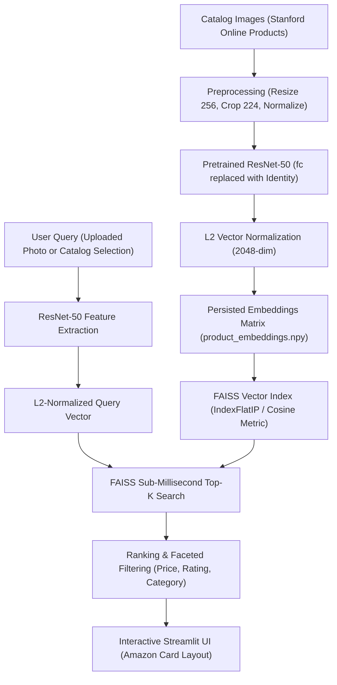

# Visual Product Similarity & Image-Based Recommendation System (Amazon-Style)


An industrial-grade, computer vision-driven visual product recommendation and reverse image search engine mimicking Amazon's **"Similar Items"**, **"Customers who viewed this item also viewed"**, and **Camera Visual Search**.

---

## 📌 Problem Statement & Business Motivation

Online marketplaces host millions of products where textual metadata (titles, descriptions, tags) is frequently noisy, incomplete, language-dependent, or misleading. Keyword search often fails when shoppers search for products characterized by aesthetics, silhouette, texture, cut, pattern, or color.

By leveraging **Deep Representation Learning** and **High-Dimensional Vector Databases**, this project eliminates reliance on manual metadata curation to deliver:
1. **Reverse Image Search ("Snap & Find"):** Upload any photo/screenshot to discover visually identical or similar inventory.
2. **Catalog Recommendations ("Visually Similar Items"):** Recommends contextually cohesive alternatives on product detail pages.
3. **Conversion Rate Uplift:** Surfaces relevant in-stock alternatives when users bounce from out-of-stock items.

---

## 🏗️ System Architecture



---

## 📐 Mathematical Formulation

### 1. Feature Representation & $L_2$ Normalization
Given an image $I$, the ResNet-50 backbone maps $I$ to a 2048-dimensional dense representation:
$$\mathbf{z} = f_{\text{ResNet50}}(I) \in \mathbb{R}^{2048}$$

To ensure consistent geometric scale and allow inner product equivalences, we apply $L_2$ normalization:
$$\mathbf{e} = \frac{\mathbf{z}}{\|\mathbf{z}\|_2} = \frac{\mathbf{z}}{\sqrt{\sum_{i=1}^{D} z_i^2}}$$

### 2. Cosine Similarity via Inner Product
When vectors are unit-normalized ($\|\mathbf{u}\|_2 = \|\mathbf{v}\|_2 = 1$), Cosine Similarity equals the dot product:
$$\text{CosineSimilarity}(\mathbf{u}, \mathbf{v}) = \frac{\mathbf{u} \cdot \mathbf{v}}{\|\mathbf{u}\|_2 \|\mathbf{v}\|_2} = \mathbf{u}^\top \mathbf{v}$$

This allows FAISS's optimized SIMD/AVX `IndexFlatIP` to perform exact cosine similarity retrieval in sub-millisecond time.

### 3. Evaluation Metrics
- **Precision@K:** Proportion of the top-$K$ recommendations that share the same ground-truth category as query item $q$:
$$\text{Precision@K} = \frac{|\{i \in \text{Top-K} \mid \text{Category}(i) = \text{Category}(q)\}|}{K}$$

- **Recall@K:** Fraction of total relevant category items retrieved in the top-$K$:
$$\text{Recall@K} = \frac{|\{i \in \text{Top-K} \mid \text{Category}(i) = \text{Category}(q)\}|}{N_{\text{category}} - 1}$$

---

## 📁 Repository Directory Structure

```
├── data/
│   ├── images/                   # 1,800 balanced product images across 12 categories
│   ├── metadata.csv              # Ground-truth labels, SKU IDs, prices, ratings
│   └── evaluation_results.json   # Precision@K, Recall@K, and Latency benchmarks
├── models/
│   ├── faiss_index.bin           # Persisted binary FAISS similarity index
│   └── product_embeddings.npy    # 2048-dim L2-normalized feature embeddings
├── src/
│   ├── __init__.py
│   ├── extract_and_prepare_data.py # Dataset extraction and metadata generation
│   ├── feature_extractor.py       # ResNet-50 feature extraction pipeline
│   ├── indexer.py                 # FAISS vector indexing & query management
│   ├── recommender.py             # End-to-end recommendation & faceted filtering
│   └── evaluate.py                # Quantitative Precision@K & latency benchmark
├── app.py                         # Amazon-style Streamlit web application
├── requirements.txt               # Project dependencies
└── README.md                      # Documentation
```

---

## 🚀 Setup & Execution Guide

### 1. Install Dependencies
```bash
pip install -r requirements.txt
```

### 2. Dataset Preparation
Extracts a balanced 1,800-image catalog across 12 e-commerce categories from `Stanford_Online_Products.zip`:
```bash
python src/extract_and_prepare_data.py
```

### 3. Build Vector Index (Offline Pipeline)
Runs ResNet-50 feature extraction and serializes the FAISS index:
```bash
python src/build_catalog_index.py
```

### 4. Run Quantitative Evaluation
Calculates Precision@K, Recall@K, and search latency distribution:
```bash
python src/evaluate.py
```

### 5. Launch the Streamlit Web App
```bash
streamlit run app.py
```

---

## 🖥️ Streamlit Application Walkthrough

The web application provides:
- **Reverse Image Search ("Camera Search"):** Upload any external image (JPG, PNG) to extract visual embeddings in real-time and retrieve visually similar catalog products with match confidence percentages.
- **Catalog Browsing ("Customers Also Viewed"):** Select any item from the catalog to see Amazon-style carousel recommendations.
- **Faceted Amazon Filters:** Filter visual recommendations by Category, Min/Max Price ($ USD), Minimum Star Rating, and Top-K slider.
- **Quantitative Metrics Dashboard:** View live Precision@1, Precision@5, Precision@10, and FAISS sub-millisecond retrieval latencies.
